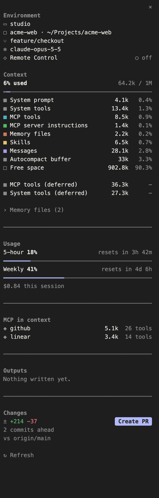

# session-panel



A side panel for the Claude Code CLI that brings the desktop app's session panel to the terminal. It shows:

- **Environment**: machine, project and folder, git branch, and whether a Remote Control client is attached
- **Context**: % used, used/total tokens, a coloured bar by category, and the `/context` rows (Messages, System tools, MCP tools, System prompt, Memory files, Skills, Autocompact buffer, Free space, deferred tools), with expandable MCP tools and Memory files lists
- **Connectors**: the MCP servers whose tools are in context
- **Outputs**: files created and artifacts published this session
- **Changes**: lines added and removed against the main branch, with a **Create PR** button

The panel docks beside the chat when the terminal is at least 144 columns wide; `/session-panel` opens it at any width. It refreshes after each reply and file edit, and has a Refresh button.

## Install

At the prompt of a terminal session:

```
/plugin install session-panel --marketplace danbaez/session-panel
```

Answer `y` to add the marketplace, then pick a scope.

From a shell:

```
claude plugin install session-panel --marketplace danbaez/session-panel
```

In the desktop app, where `/plugin` does not run: click + next to the prompt box, then Plugins, Add marketplace with `danbaez/session-panel`, then Add plugin.

## Uninstall

```
/plugin uninstall session-panel
```

## Contributing

Issues and pull requests are welcome. The panel is a single module, `hooks/register.tsx`, with its data types in `types/index.d.ts` and a render test in `hooks/pane.test.tsx`.

## License

[MIT](LICENSE)
